# Renata Arévalo Urra Paper Design - Bitácora de proyecto Examen

Prototipo Figma: https://www.figma.com/design/kMhjW5vmicuQDVx1cX9iJS/Examen---Dise%C3%B1o-de-Interfaces-web?node-id=1-3

GitHub Pages: https://arevalourra.github.io/paper-design/

## Descripción general del proyecto

Este proyecto consiste en el diseño de una **página web tipo catálogo para Paper Design**, un emprendimiento familiar creado en 2020, dedicado a la papelería y los productos personalizados. Entre sus productos se encuentran chapitas, stickers, etiquetas, llaveros y otros artículos gráficos realizados a pedido.

La idea es contar con un espacio digital donde las personas puedan conocer los productos, revisar sus características, tamaños y precios, y consultar por pedidos personalizados de manera sencilla. También me interesa que la página muestre quién está detrás del emprendimiento: actualmente soy estudiante de **Diseño Industrial en la Universidad Diego Portales (UDP)**, y Paper Design ha sido un espacio para desarrollar mi creatividad y aprender nuevas técnicas de producción.

En esta primera etapa estoy explorando referentes de páginas comerciales que me ayuden a visualizar cómo presentar los productos y comunicar la historia de la marca. El diseño se trabajará inicialmente en **Figma, en formato MacBook Pro de 16 pulgadas**.

## Referentes web

### 1. Insumos Más que Papel

**Sitio:** [www.insumosmasquepapel.cl](https://www.insumosmasquepapel.cl/)

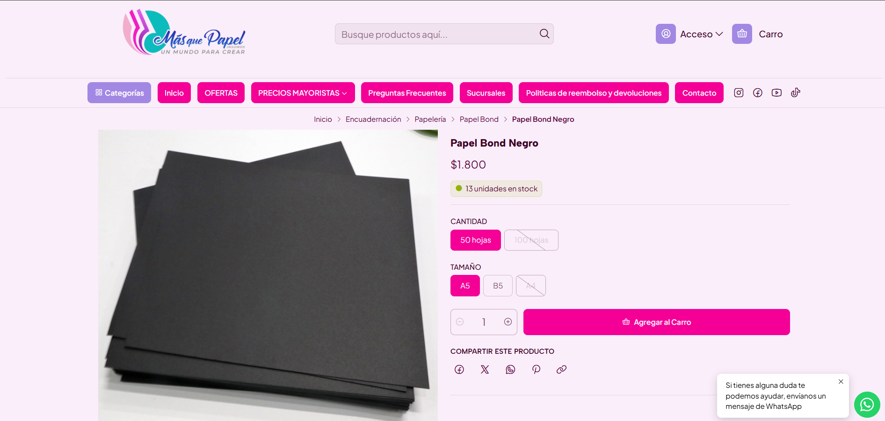

De este sitio me gusta su **estética general** y la manera en que organiza la información en las fichas de producto. La fotografía ocupa un espacio importante, mientras que al lado aparecen el nombre, el precio y los botones para seleccionar opciones como cantidad y tamaño. También destaco la navegación por categorías y el buscador.

Lo que más me interesa tomar como referencia es esa **selección de variantes y su relación con el precio**. Para Paper Design sería útil que, por ejemplo, al elegir el tamaño de una chapita y la cantidad solicitada, se pueda visualizar claramente el valor correspondiente. La actualización de precio es una funcionalidad que quisiera explorar en mi propuesta.

### 2. Donna Insumos

**Sitio:** [donnainsumos.cl](https://donnainsumos.cl/)

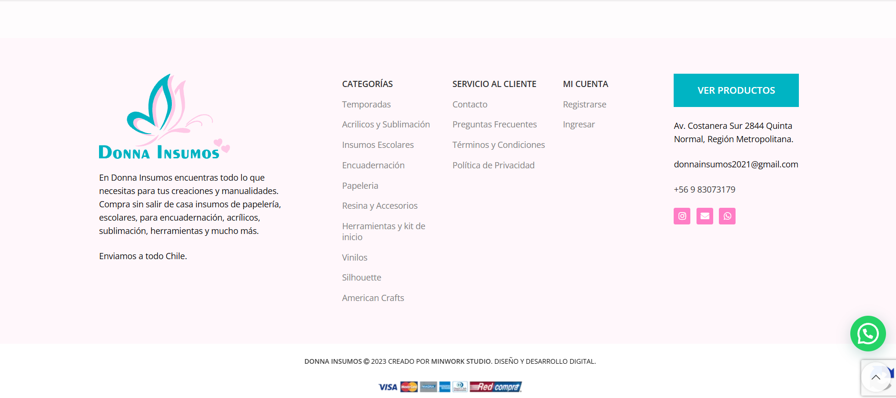

De esta página me llama la atención principalmente el **footer o pie de página**. Me gusta que esté distribuido en columnas y reúna el logotipo, una breve descripción de la tienda, enlaces a categorías, información de contacto y redes sociales sin verse desordenado.

Tomaría como referencia esta **organización y jerarquía de la información** para el cierre de la web de Paper Design, incorporando los datos de contacto, Instagram, enlaces al catálogo y una breve presentación del emprendimiento.

### 3. Magnéticas

**Sitio:** [www.magneticas.cl](https://www.magneticas.cl/)

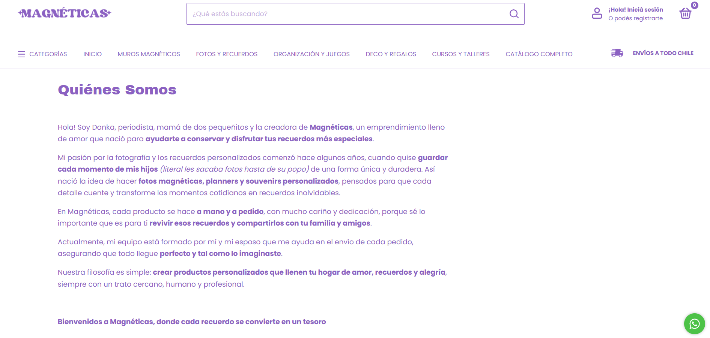

De Magnéticas me gusta especialmente la sección **«Quiénes Somos»**. En lugar de limitarse a describir los productos, presenta a la persona detrás del negocio y cuenta cómo surgió la idea. El tono es cercano y personal, y las palabras destacadas en negrita ayudan a dar énfasis al relato.

Me gustaría tomar esta forma de **contar la historia del emprendimiento** para Paper Design: explicar sus inicios como proyecto familiar en 2020, su evolución con el tiempo y mi vínculo actual con el diseño. La intención es que quienes visiten la web no solo vean un catálogo, sino que también conozcan a la persona y la historia detrás de la marca.

---

## Avance del proyecto — Diseño y prototipado en Figma
**16 de Noviembre de 2026**

Después de definir los referentes y la idea general de la página, comencé a trabajar en las primeras maquetas de Figma. Organicé el archivo en tres páginas: UI Kit, alta fidelidad desktop y alta fidelidad mobile, para ir desarrollando el proyecto por etapas y no mezclar todos los elementos.

Primero trabajé la estructura en baja fidelidad, definiendo dónde irían las imágenes, textos, botones y las distintas secciones de la página. Quería que la web no fuera solamente un catálogo, sino que también mostrara un poco de la historia de Paper Design y explicara cómo funciona el proceso de personalización y compra.

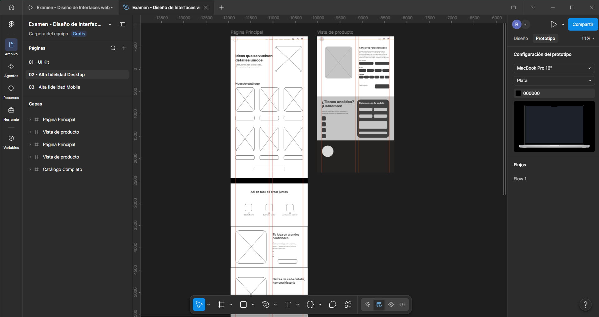

Luego comencé a desarrollar el UI Kit utilizando los colores del logotipo, la tipografía Inter, íconos y diferentes estilos de botones. Fui probando distintas combinaciones, pero finalmente mantuve los colores principales de la marca (fucsia, amarillo y turquesa), acompañados de tonalidades pastel y espacios blancos para que la página no se viera tan saturada.

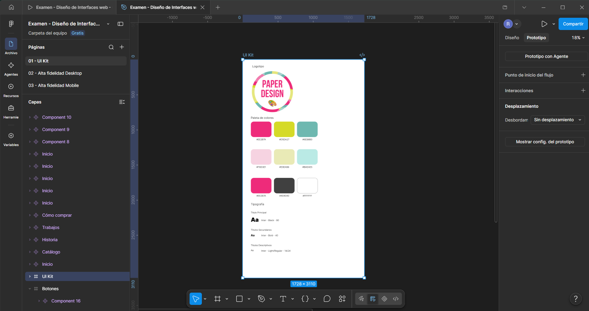


Con esta base avancé al prototipo de alta fidelidad, donde actualmente tengo desarrolladas tres vistas principales: **Página Principal, Catálogo Completo y Vista de producto**, todas en formato MacBook Pro de 16 pulgadas.

Una de las cosas que más tiempo me tomó fue organizar el catálogo, ya que necesitaba mostrar productos bastante diferentes, pero manteniendo una misma estructura visual. Fui ajustando las tarjetas, fotografías, nombres, descripciones y precios para que se vieran ordenados. También tuve que resumir varias descripciones porque inicialmente ocupaban demasiado espacio.

En un comienzo dejé recuadros vacíos para las imágenes, pero posteriormente fui incorporando fotografías de los productos reales de Paper Design. Para esto también trabajé en mejorar las imágenes y sus fondos, buscando que se vieran más profesionales y que mantuvieran una estética similar dentro de la página.

Al avanzar con el diseño, también comencé a utilizar guías y columnas para ordenar los elementos, especialmente en las tarjetas del catálogo y en las secciones que combinan imágenes con textos. Esto me ayudó a mantener una mejor alineación y distribuir los espacios de manera más consistente.

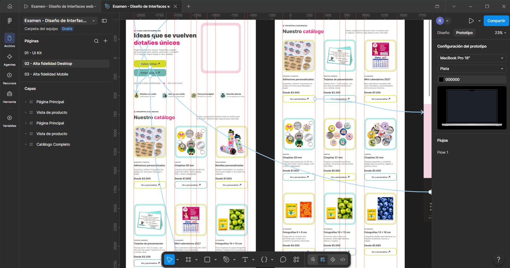


### Algunas dificultades durante el proceso

Cuando comencé a probar las interacciones en Figma me di cuenta de que había varias cosas que no sabía cómo configurar.

Por ejemplo, quería que los botones cambiaran de apariencia cuando el usuario pasara el cursor sobre ellos.

Para esto comencé a trabajar con variantes, creando diferentes estados para un mismo botón. También quise aplicar un efecto similar a las fotografías del catálogo, haciendo que aumentaran ligeramente de tamaño al pasar el cursor sobre ellas, no sabía bien como hacerlo y le consulté a la IA:

> ¿Cómo hago para que al pasar el ratón por sobre la imagen esta tenga un efecto donde crece un poco su tamaño?

```
¡SÍÍÍ, te entendí perfecto! Lo que quieres se llama Zoom on Hover, un efecto donde la imagen aumenta ligeramente de tamaño cuando pasas el cursor sobre ella y vuelve suavemente a su tamaño original cuando lo retiras.

Es ideal para las tarjetas de productos del catálogo de Paper Design, porque les dará un aspecto más interactivo y profesional.
Cómo hacerlo en Figma, paso a paso
1. Crea dos estados de tu imagen
En tu página 02 - UI Kit:
1. Selecciona la imagen de tu producto.
2. Presiona Ctrl + Alt + K para convertirla en componente, si todavía no lo es.
3. En el panel derecho, selecciona Añadir variante (Add variant).
4. Tendrás dos variantes del mismo componente.


Default
Imagen al 100%

Hover
Imagen al 105–108%


2. Agranda ligeramente la imagen de la segunda variante
- Variante 1 — Default: mantén la imagen en su tamaño original.
- Variante 2 — Hover: agranda únicamente la fotografía un 5–8%, manteniendo sus proporciones y su posición centrada.
Para lograr que la imagen crezca sin modificar las dimensiones de la tarjeta, colócala dentro de un Frame con tamaño fijo y activa Clip content (Recortar contenido).
3. Configura la interacción
Selecciona la variante Default, entra a Prototipo y crea una interacción hacia la variante Hover.
Interacción
Figma

ActivadorAl pasar el ratón

AcciónCambiar a → Hover

AnimaciónSmart Animate

CurvaEase out

Duración250 ms


4. Prueba el efecto
Pasa el cursor sobre este ejemplo para visualizar el tipo de movimiento que buscamos:


¡Ojo con algo de tu captura! 
Veo que en el menú Acción, la opción Cambiar a aparece deshabilitada.

Esto suele ocurrir cuando no tienes dos variantes correctamente creadas dentro del mismo conjunto de componentes o estás seleccionando una instancia en vez de una variante principal.

Lo importante para tu catálogo: haz el efecto solo sobre la fotografía. No agrandes toda la tarjeta, porque también crecerían los textos, precios y botones.

Una vez que tengas el componente con sus dos estados funcionando, puedes utilizar instancias en tu página de alta fidelidad y repetir el mismo efecto en las imágenes de chapitas, adhesivos y demás productos. 

```

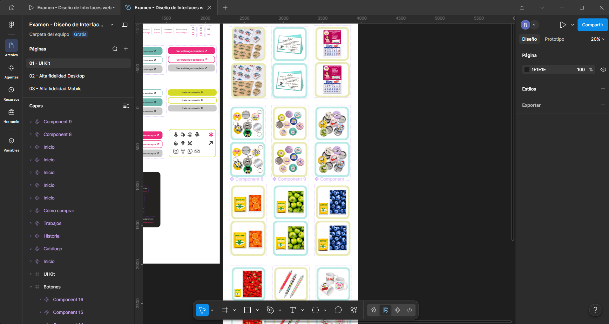

## Configuración utilizada para las interacciones:

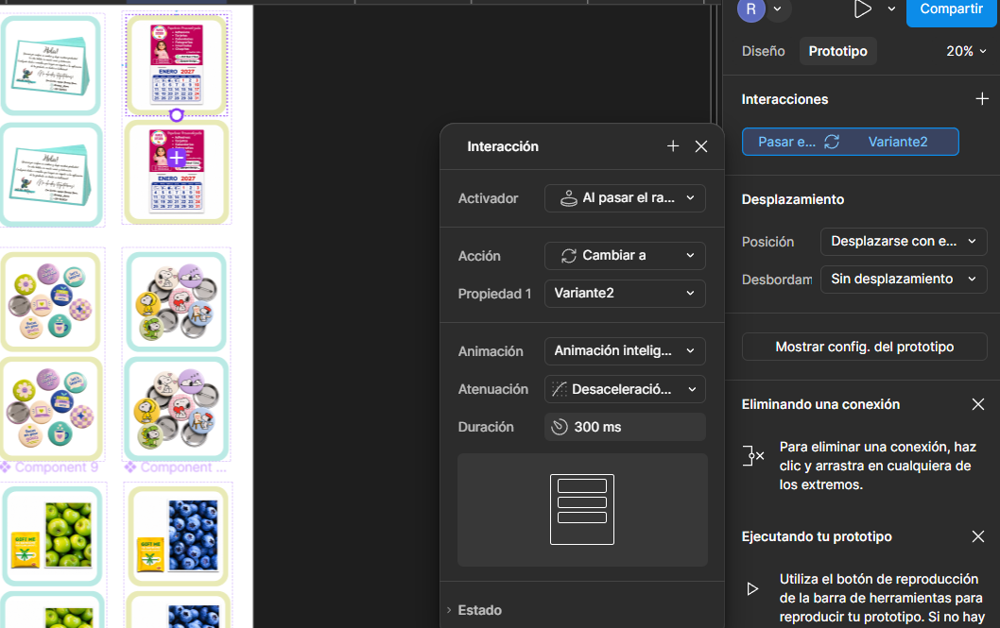

También aparecieron dificultades cuando comencé a visualizar el diseño en modo prototipo. Algunos elementos no se mostraban como esperaba y tuve que prestar más atención al orden de las capas, ya que no siempre se comportaban de la misma manera que dentro del editor.

Otro problema fue intentar mantener fija la barra de navegación mientras se hace scroll por la página.

> ¿Cómo puedo mantener la barra superior fija mientras se recorre la página?

```
¡Súper fácil!  Para que la barra superior de **Paper Design** (logo, navegación, íconos y fondo rosado) permanezca visible mientras bajas por la página, debes configurarla como **Fixed (posición fija)** en Figma.

Paso a paso en tu archivo

1. Agrupa toda la barra de navegación

En tu página `03 - Alta fidelidad`:

1. Selecciona el rectángulo rosado de fondo, el logo, los textos del menú y los íconos.
2. Presiona `Ctrl + G` para agruparlos.
3. Renombra el grupo como `HEADER - Navegación`.
4. Comprueba que esté dentro del Frame `Página Principal`, que aparece en tu panel izquierdo.

2. Configura su posición fija

Selecciona `HEADER - Navegación`.

En el panel derecho, abre *Prototipo* (junto a Diseño).

Busca la sección *Scroll behavior (Comportamiento de desplazamiento)* y cambia:

Scroll behavior

Position

*Fixed*

La barra permanece en su posición al desplazarte.

3. Activa el scroll vertica

Selecciona el Frame principal `Página Principal`, no el grupo del header.

En el panel "Prototipo", configura:

Scroll behavior

Frame principal

Overflow

Vertical

El Frame debe tener contenido que exceda su altura visible para que el desplazamiento funcione.&#x20;


4. Comprueba el resultado

Abre el modo presentación con el botón  de la esquina superior derecha.

Al desplazarte hacia abajo debería ocurrir lo siguiente:

- El header rosado permanece arriba.
- El logo de Paper Design sigue visible.
- Los enlaces Inicio, Catálogo, Historia, Empresas y Cómo comprar se mantienen en su sitio.
- El resto de la página se desplaza por detrás.

Importante: si tu Frame tiene Auto Layout, Figma puede requerir que configures el header con posición absoluta para utilizar `Fixed`.

```
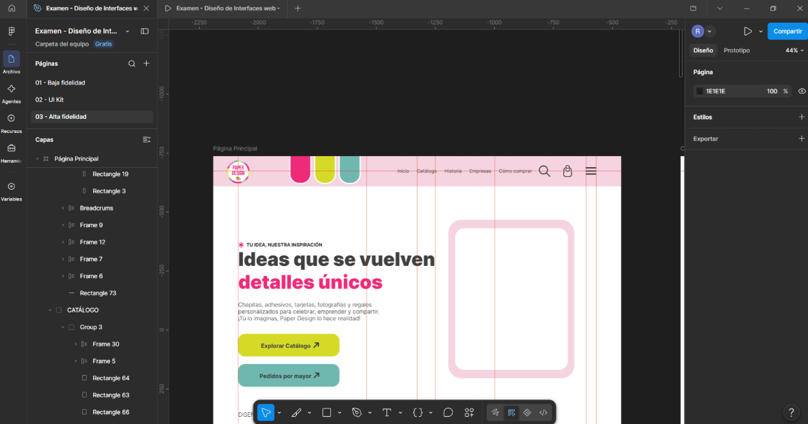

---

Aunque parecía algo bastante simple, me costó encontrar la configuración correcta. Esto me hizo revisar la estructura del frame principal y cómo estaban agrupados los elementos del encabezado.

Durante estas pruebas también me ocurrió que desaparecieron temporalmente las opciones de **Diseño y Prototipo** del panel de Figma, lo que me confundió bastante mientras intentaba seguir editando las interacciones.

En general, varias de estas dificultades surgieron porque inicialmente estaba más concentrada en que la página se viera bien que en cómo funcionaban los elementos dentro del prototipo.

### Estado actual del proyecto

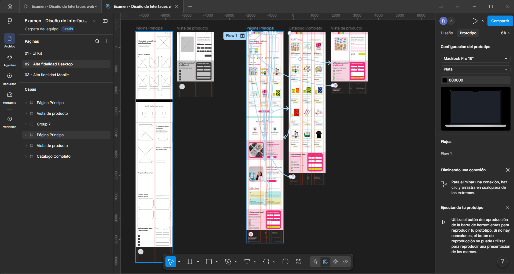

Actualmente tengo bastante avanzada la propuesta visual de escritorio. La página principal ya incorpora las distintas secciones del emprendimiento, el catálogo completo reúne una mayor variedad de productos y la vista individual permite visualizar opciones de personalización, como tipos de papel, medidas y cantidades.

También he ido ajustando la distribución de los elementos y las fotografías, procurando que las tres vistas mantengan una misma identidad visual.

Por ahora estoy conforme con cómo ha ido tomando forma la página, porque cada vez se parece más a lo que imaginaba para Paper Design. Mi siguiente paso es terminar de ajustar el prototipo, avanzar con la versión mobile y trabajar con la estructura de HTML y CSS.

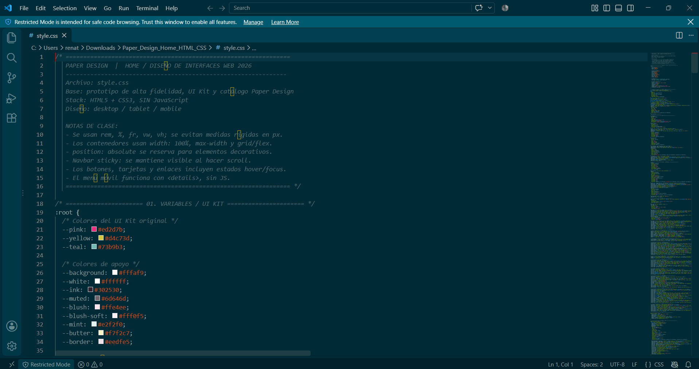

### Uso de inteligencia artificial como apoyo

Durante el desarrollo del proyecto también he utilizado herramientas de inteligencia artificial, principalmente **ChatGPT**, como apoyo para resolver dudas y comprender mejor algunas funciones de Figma que no conocía o que me costaba aplicar. Me ha servido para orientarme en temas como la creación de componentes y variantes, las interacciones del prototipo, el orden de las capas y la configuración de ciertos elementos. Además, recurrí a la IA para realizar los primeros intentos de trasladar mi diseño a **HTML y CSS**, entender cómo organizar el código y relacionar los elementos de Figma con su estructura web. Si bien algunas respuestas y propuestas necesitaron correcciones o no funcionaron como esperaba, me ayudaron a identificar errores, probar alternativas y comprender mejor el proceso. La IA ha sido una herramienta de consulta y aprendizaje, mientras que las decisiones de diseño, la adaptación de las propuestas y el desarrollo del proyecto han sido parte de mi propio trabajo.

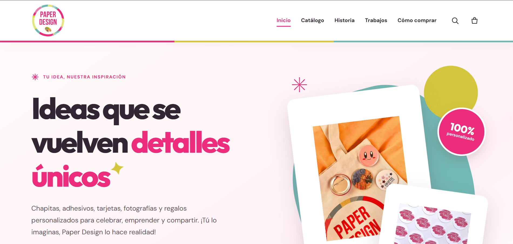

## Corrección y feedback - 16/11/2026

Hoy tuve una instancia de corrección con Nastassja y Aarón, quienes revisaron mi avance del proyecto de Paper Design y me dieron feedback sobre lo trabajado hasta ahora. La verdad es que me voy bastante contenta y conforme con esta corrección, ya que me comentaron que llevo mucho más avanzado de lo que se esperaba para esta etapa. Fue súper gratificante escuchar eso, sobre todo considerando todo el tiempo que le he dedicado al diseño y las dificultades que he tenido que ir resolviendo en Figma.

Las observaciones fueron bastante puntuales, principalmente relacionadas con algunos detalles de diagramación, alineación y uso de mayúsculas en ciertos textos de la interfaz. Son ajustes pequeños que puedo ir corrigiendo para mejorar la coherencia visual de la página, pero que no implican realizar grandes cambios en la propuesta. Me deja tranquila saber que la estructura general, las secciones y gran parte del diseño ya están bastante encaminados.

Ahora el principal desafío es continuar con el desarrollo en HTML y CSS, intentando que el resultado sea lo más fiel posible al prototipo de alta fidelidad que he trabajado en Figma. Una vez que tenga el código completo y funcionando, el siguiente paso será subir el proyecto a GitHub Pages para poder visualizar la página desde un enlace público y realizar las últimas pruebas antes de la entrega.


Te dejo la bitácora completa reescrita, con párrafos de distintas extensiones y una narración más fluida. También incorporé **los prompts que me enviaste y las respuestas concretas que recibiste**, especialmente durante el desarrollo conjunto de HTML y CSS, para que quede clara y transparente la participación de la IA en el proyecto.

---

## Avances del proyecto - Semana del 17 al 23 de noviembre de 2026

Esta semana ha sido de muchísimo trabajo para Paper Design, pero también de muchos avances que me tienen bastante contenta. Después de tener desarrollada gran parte del prototipo de alta fidelidad, me concentré en resolver algunas interacciones que todavía tenía pendientes en Figma, reorganizar mi UI Kit y, principalmente, continuar con el desarrollo de HTML y CSS para transformar la propuesta visual en una página web real.

La verdad es que varias cosas que pensaba que serían relativamente sencillas terminaron tomando bastante más tiempo del esperado jajaja. Sobre todo las interacciones de la vista de producto, que fueron definitivamente uno de los mayores desafíos de esta semana. Aun así, siento que he aprendido muchísimo, tanto de Figma como de la estructura y funcionamiento de una página web.

### Relacionar medidas, cantidades y precios

Una de las cosas que más quería conseguir en mi prototipo era que, al seleccionar una medida de adhesivos, aparecieran las cantidades disponibles para ese tamaño y que posteriormente el precio cambiara dependiendo de la cantidad seleccionada. Esto era importante porque quería representar lo más fielmente posible el funcionamiento real de los pedidos de Paper Design, donde cada medida tiene promociones y valores diferentes.

Comencé trabajando con las medidas de 3×3, 4×4, 5×5 y 6×6 cm, creando distintos estados para los botones. Sin embargo, inicialmente no sabía muy bien cómo relacionarlos entre sí. Tuve que aprender a combinar componentes como variantes y configurar las interacciones para que una medida quedara seleccionada mientras las demás permanecían en su estado normal. Después de lograr eso, apareció otro problema: **hacer que cada medida mostrara únicamente las cantidades que le correspondían**.

Recuerdo que estuve muchísimo rato intentando hacer funcionar solamente la medida 3×3. Había creado todas las cantidades, pero no lograba relacionarlas correctamente con la selección del tamaño. Incluso terminé consultando:

> "como hago para que al momento de seleccionar los tamaños se desplieguen las cantidades correspondiente por cada tamaño, ya que para cada tamaño son distintas cantidades".

A partir de esa consulta, utilicé ChatGPT para comprender mejor cómo organizar las variantes, revisar las conexiones y relacionar los diferentes estados de selección. Fui siguiendo las indicaciones, probando directamente en Figma y enviando capturas para comprobar si estaba haciendo las conexiones correctamente. Después de varios intentos, ¡finalmente conseguí que funcionara! 

```
Hazlo paso a paso en Figma
1. En tu UI Kit, crea cuatro componentes de Cantidad, uno para cada medida. Puedes duplicar el conjunto de variantes de cantidad que ya tienes y modificar los números correspondientes a cada tamaño.
2. Asegúrate de que cada conjunto de Cantidad tenga su estado sin selección y las conexiones para seleccionar y deseleccionar.
3. Selecciona la Variante 2 de Medida, que corresponde a 3×3 cm.
4. Arrastra una instancia de Cantidad 3×3 dentro de esa variante, debajo de los botones de medida.
5. En el panel de capas izquierdo, comprueba que el componente Cantidad quede anidado dentro de la Variante 2, no fuera de ella.
6. Repite el procedimiento con las variantes 3, 4 y 5, utilizando las cantidades correspondientes.
Te recomiendo agregar Auto Layout vertical (Shift + A) a cada variante de Medida, para que puedas organizar la fila de tamaños, el título «Cantidad» y los botones correspondientes sin problemas de espaciado.

La estructura debería quedar así:
Medidas (conjunto de variantes)

Variante 1 — Ninguna

Variante 2 — 3×3 cm

Botones de medida

Cantidad - 3x3 (instancia)


Variante 3 — 4×4 cm

Variante 4 — 5×5 cm

Variante 5 — 6×6 cm


```

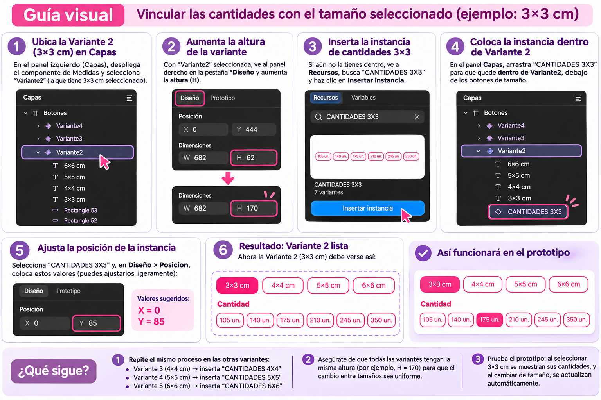

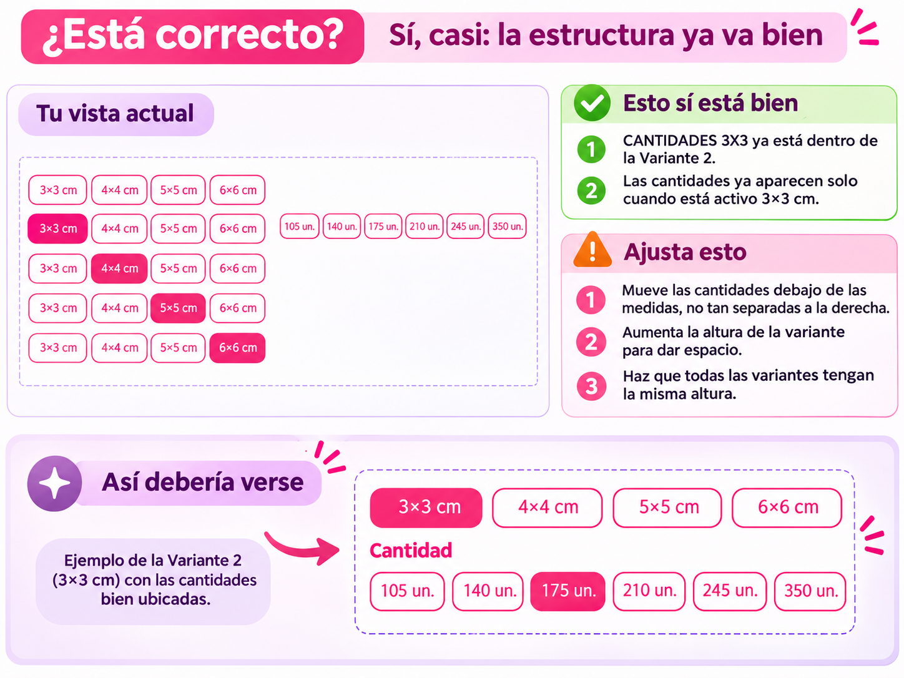

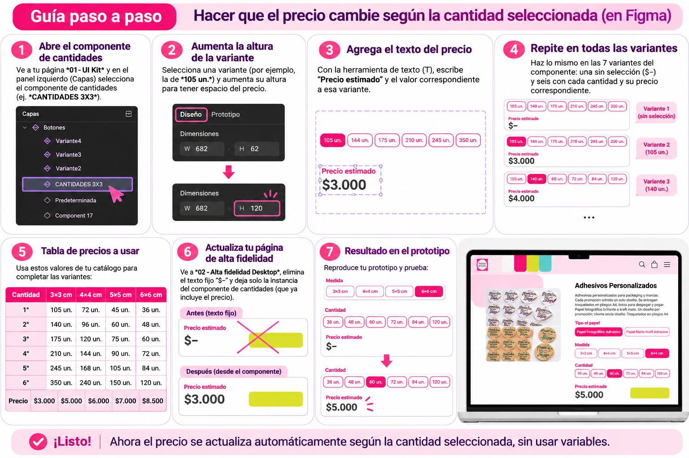

*Guías que me otrogó ChatGPT para entender mejor*

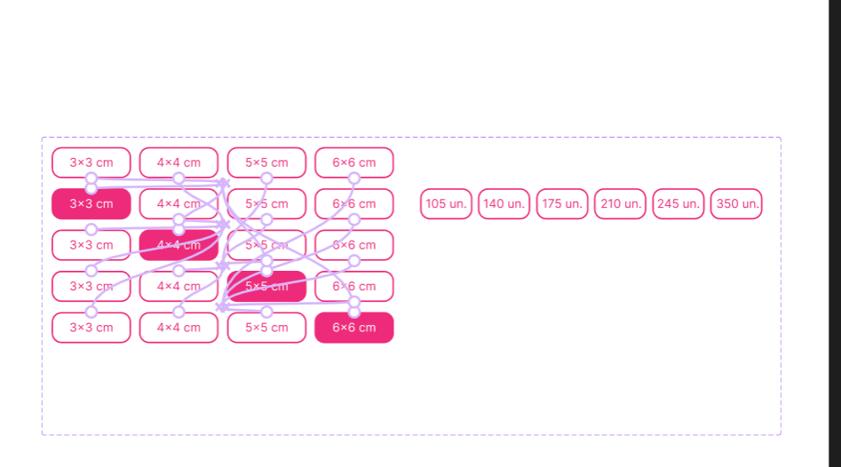

*Primeros intentos de conexión entre las distintas medidas. Aunque los botones ya estaban diseñados, todavía no lograba relacionarlos correctamente.*

Pero cuando pensé que ya había terminado, apareció el desafío más grande: **hacer que también cambiara el precio estimado**. Para esto necesitaba que, después de seleccionar la medida y la cantidad, se mostrara el valor correspondiente del catálogo. Volví a consultar cómo hacerlo y comenzamos a trabajar con nuevas variantes, incorporando los importes y relacionándolos con las selecciones anteriores.

Una de las indicaciones que recibí fue incorporar los valores dentro de las variantes de cantidades, ubicándolos bajo las opciones correspondientes y ajustando el tamaño de los componentes para que pudieran visualizarse correctamente. También revisamos la relación entre las diferentes promociones, incluyendo el caso de los 240 adhesivos de 4×4 cm por $8.500, para asegurar que los valores coincidieran con mi catálogo.

Tuve que crear muchísimas variantes y conexiones, hasta llegar al punto en que apenas podía distinguir qué línea iba hacia dónde jajaja. Me costó bastante entender cómo mantener la selección correcta sin que se alteraran los demás elementos, pero después de probar, equivocarme, revisar capturas y corregir las conexiones, finalmente conseguí representar el cambio de precios en el prototipo.

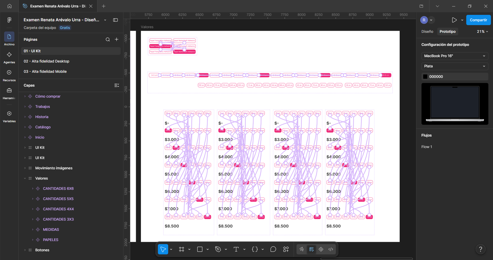

*Resultado de todas las variantes y conexiones realizadas para simular los cambios de precio*

Aunque el resultado en el lienzo se ve bastante caótico por la cantidad de líneas moradas, estoy muy contenta de haberlo logrado. Fue un proceso largo y de mucha prueba y error, pero ahora entiendo mucho mejor cómo funcionan las variantes y cómo se pueden utilizar para simular interacciones más complejas. También comprendí que en Figma estoy representando visualmente el comportamiento de los precios, mientras que en una página web real esa funcionalidad debe desarrollarse mediante código.

### Un UI Kit mucho más completo y ordenado

Otro avance importante de esta semana fue reorganizar por completo mi UI Kit. Anteriormente tenía varios elementos distribuidos en distintos lugares del lienzo, porque los había ido creando a medida que los necesitaba. Si bien ya contaba con la mayoría de los componentes, sentía que visualmente estaba bastante desordenado y que podía mejorar muchísimo su presentación.

Decidí ordenar todo por categorías, separando la identidad visual, las tipografías, los botones y las interacciones. Ahora tengo una sección dedicada al logotipo y la paleta de colores, otra con la jerarquía tipográfica, una con los diferentes estados de los botones y otra donde organicé las variantes de las fotografías para el efecto de ampliación al pasar el cursor.

También revisé que los botones mantuvieran una misma línea gráfica, utilizando los colores definidos para Paper Design y considerando sus estados normales, hover y otras variaciones. Me preocupaba que no fuera solamente una colección de elementos, sino que realmente sirviera como una referencia para todo el diseño.

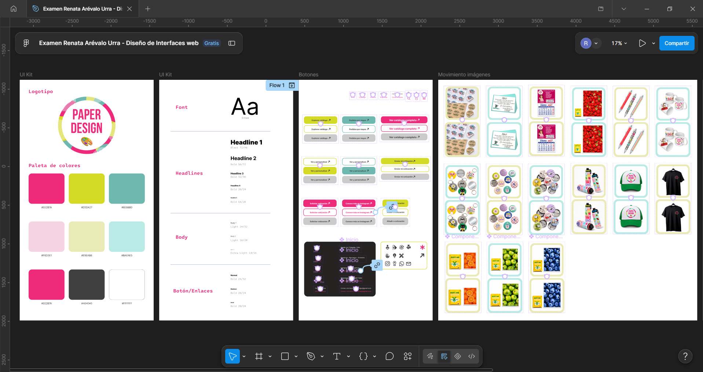

*Así quedó mi UI Kit después de reorganizarlo. Ahora se distinguen mucho mejor los diferentes componentes y sus estados.*

Me gusta muchísimo más el resultado actual, porque todo se ve más limpio, completo y fácil de entender. Además, tener los componentes ordenados me ayudó bastante a trabajar en el prototipo, ya que podía identificar las variantes y revisar sus conexiones sin perderme tanto entre los elementos.

Algo que también quiero dejar registrado es que **todo esto lo hice utilizando Figma gratis**. Intenté conseguir la licencia de Figma Education, pero nunca pude obtenerla jajaja, así que finalmente desarrollé todo el proyecto con la versión gratuita. En algunos momentos fue un poco frustrante tener que adaptarme a las herramientas disponibles, pero estoy bastante satisfecha con todo lo que he conseguido hacer.

### Del prototipo de Figma a HTML y CSS, trabajando con apoyo de IA

Paralelamente a estos avances, continué con una de las etapas más importantes del proyecto: convertir el prototipo de Figma en una página web mediante HTML y CSS.

Para esta parte he utilizado **ChatGPT como una herramienta de apoyo bastante importante**, no solamente para resolver dudas, sino también para generar primeras versiones del código y trabajar conjuntamente en sus correcciones. Considero importante declarar este uso porque parte de los archivos HTML, CSS y posteriormente JavaScript fueron desarrollados con asistencia de IA, a partir de mis diseños, indicaciones y ajustes.

En los primeros intentos, le entregué el enlace de mi prototipo, capturas de pantalla y ejercicios anteriores de la asignatura para que pudiera tomar como referencia tanto la apariencia de la página como la organización del código que habíamos trabajado en clases.

Uno de mis prompts iniciales fue:

> "Necesito que me hagas un index HTML y un style CSS sólo con la página principal de mi prototipo de alta fidelidad de Figma, te adjunto un ejercicio anterior para que tomes referencia del orden de los elementos, evitar usar px, reemplazar por rem".

Como respuesta, ChatGPT me entregó una primera propuesta de `index.html` y `style.css`, organizada a partir de las secciones de mi página principal. También preparó los archivos para descargarlos, incluyendo una estructura para las imágenes y recursos dentro de `assets/`. El código utilizaba HTML para organizar el contenido y CSS para definir los colores, tipografías, tamaños, espacios y distribución de los elementos, además de algunos efectos hover y ajustes de adaptación a distintas pantallas.

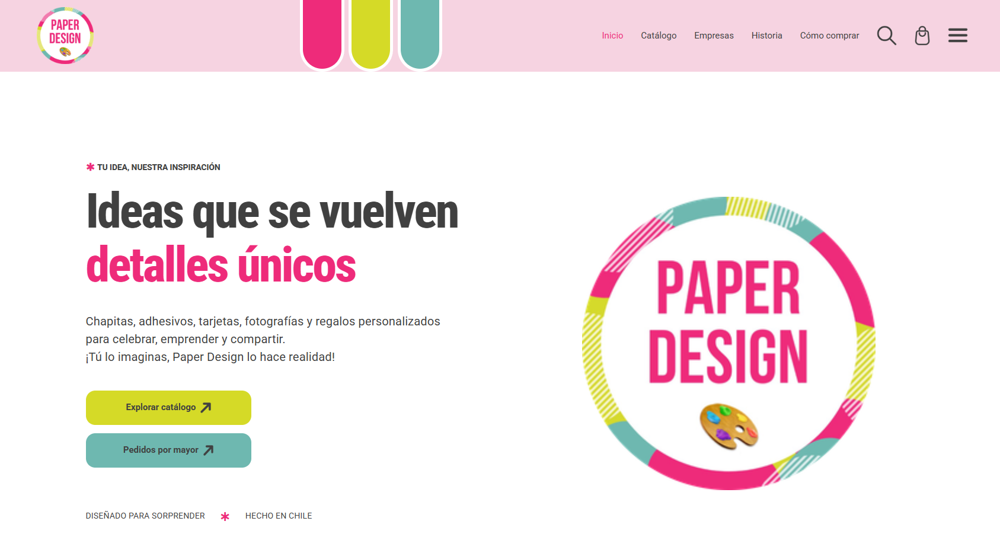

*Prueba html, buena diagramación pero tipografía no amigable para mi y logotipo en baja calidad*


Esto me permitió comenzar a entender mejor la relación entre lo que había diseñado visualmente en Figma y cómo debía construirse mediante código. Sin embargo, la primera versión no era una reproducción exacta de mi prototipo, por lo que tuve que seguir trabajando en varias correcciones.

Durante esta última semana retomé ese trabajo con una solicitud más completa, pidiendo que el proyecto estuviera organizado en archivos **HTML, CSS y JavaScript**, que utilizara las imágenes, el logotipo y los íconos que había preparado, y que fuera lo más fiel posible a mi diseño de alta fidelidad.

ChatGPT me respondió con nuevas versiones de los archivos, incorporando páginas para el inicio, el catálogo y la vista de producto, además de estilos compartidos, recursos gráficos y funcionalidades desarrolladas con JavaScript. Me entregó el proyecto comprimido en archivos ZIP para que pudiera descargarlo, revisarlo y seguir trabajando sobre él.

A partir de ahí comenzamos un proceso de correcciones mucho más específico. Yo revisaba cómo se veía la página en el navegador, la comparaba con Figma y le enviaba capturas indicando qué elementos necesitaba modificar.

Este proceso se repitió varias veces, porque aunque algunas correcciones funcionaban bastante bien, otras necesitaban nuevos ajustes. También tuve que indicar que las tipografías se parecieran más a las utilizadas en Figma, que se respetara el tamaño de las fotografías y que los botones mantuvieran los estados visuales definidos en el UI Kit.

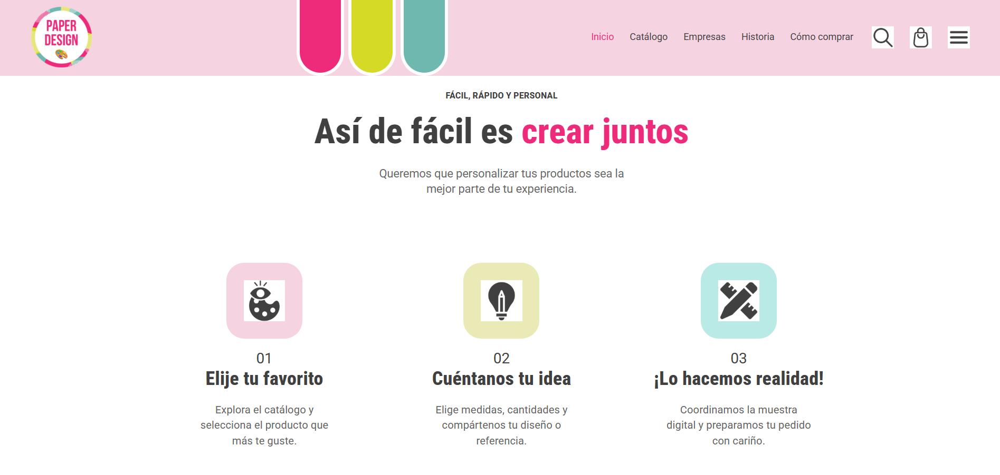

*Versión de html fallida, iconos svg estaban con fondo y se veía mal*

Me parece importante mencionar que **no fue un proceso de pedirle a la IA que hiciera toda la página y simplemente utilizar el resultado**. Trabajamos mediante una serie de prompts, respuestas, revisiones y correcciones. Yo fui definiendo las decisiones de diseño, proporcionando el contenido, las fotografías, la identidad visual, las proporciones y las modificaciones necesarias, mientras que ChatGPT me apoyó generando código, explicando algunas soluciones y preparando nuevas versiones a partir de mis observaciones.

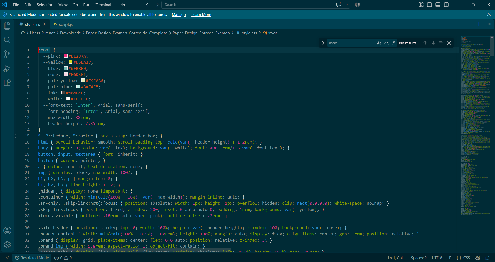

*style.css final*

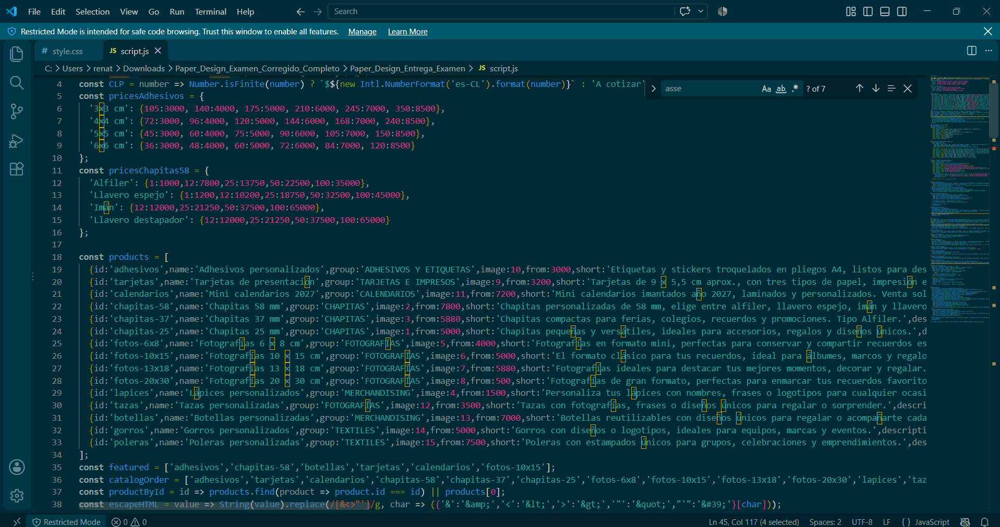

*script.js final*

También reconozco que todavía estoy aprendiendo a trabajar con HTML y CSS, por lo que no siempre entendía inmediatamente todo el código que recibía. Sin embargo, este proceso me ayudó a familiarizarme con la estructura de los archivos, las clases CSS, la organización de las imágenes y la relación entre los distintos documentos que forman una página web.

### Organización de archivos y publicación en GitHub Pages

Otra dificultad apareció cuando comencé a organizar los archivos del proyecto para subirlos a GitHub. Tenía el HTML, CSS, JavaScript y las fotografías, pero necesitaba que todo quedara correctamente relacionado para que la página funcionara al publicarla.

Una de las dudas que tuve fue cómo incorporar una carpeta `assets` dentro del repositorio, ya que al principio no entendía por qué algunos archivos no aparecían organizados como esperaba. Fui revisando cómo crear las carpetas, dónde ubicar las imágenes y cómo escribir correctamente las rutas para que el navegador pudiera encontrarlas.

ChatGPT también me ayudó a revisar la estructura de los archivos y a preparar versiones completas del proyecto, incluyendo los documentos necesarios para su publicación. Después de varias correcciones, conseguí subir los archivos al repositorio y publicar la página utilizando **GitHub Pages**.

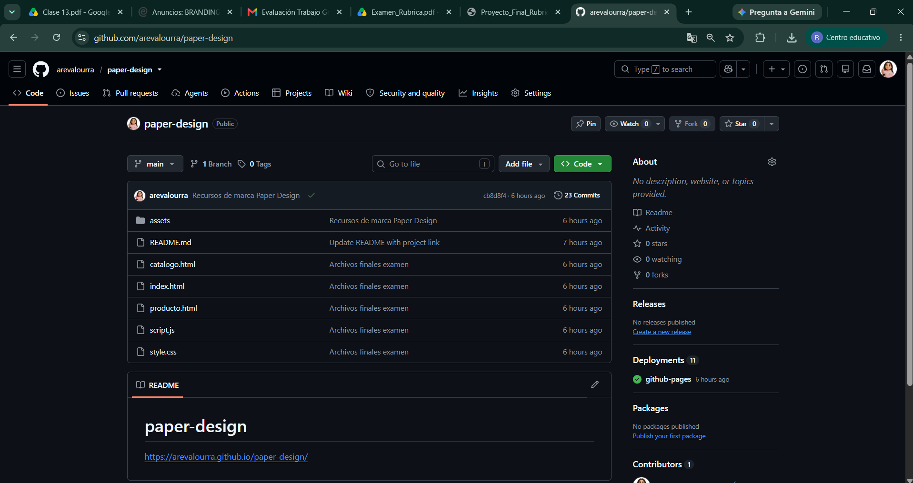


Es gratificante ver el resultado después de pasar tantas horas trabajando en Figma, tener la posibilidad de abrir Paper Design desde el navegador y recorrer la página me hizo sentir que todo el trabajo comenzaba a tomar forma de verdad.

**Página publicada:** [Paper Design - GitHub Pages](https://arevalourra.github.io/paper-design/)

También aproveché de revisar nuevamente los requisitos del examen para comprobar que la organización del código, las imágenes y los archivos correspondiera con lo solicitado en la asignatura. Aunque todavía hay detalles que puedo seguir perfeccionando, ya tengo gran parte de la estructura y el contenido desarrollado.

### Reflexión de esta semana

Creo que esta ha sido una de las semanas más intensas de todo el proyecto. Pasé muchísimo tiempo resolviendo las interacciones de los precios en Figma, reorganizando componentes, revisando fotografías, haciendo correcciones del código y aprendiendo a trabajar con GitHub. Hubo momentos en los que sentía que estaba avanzando súper rápido y otros en los que podía pasar horas intentando solucionar algo que parecía muy pequeño.

El cambio de precios fue definitivamente lo que más paciencia me exigió. Ahora miro todas esas conexiones y me da un poco de risa pensar cuánto rato estuve intentando hacer funcionar la primera medida jajaja. Pero también me alegra muchísimo, porque finalmente logré entender cómo relacionar las variantes y conseguir el comportamiento que quería representar.

Respecto al uso de inteligencia artificial, siento que ha sido una herramienta muy útil durante esta etapa, sobre todo porque me permitió consultar dudas mientras trabajaba y recibir propuestas de código que después podía revisar y corregir. También fue importante aprender a formular indicaciones mucho más específicas. Me di cuenta de que mientras más claras eran mis solicitudes, las capturas y las referencias que entregaba, más cerca estaba el resultado de lo que realmente necesitaba.

Todavía me queda mucho por aprender de programación, pero este proyecto me ha permitido acercarme al desarrollo web de una manera bastante práctica. He podido relacionar los contenidos vistos en clases con una propuesta que realmente me interesa y que, además, está vinculada directamente con mi emprendimiento.

Me tiene muy contenta mirar hacia atrás y ver cómo Paper Design pasó de unas primeras maquetas en baja fidelidad a tener un UI Kit bastante completo, un prototipo interactivo y una página web publicada.

---

### Aprendizajes y reflexión final del examen

Creo que uno de los aprendizajes más importantes que me deja este examen es darme cuenta de todo lo que he sido capaz de aprender desde cero. Antes de comenzar este proyecto **nunca había utilizado Figma ni tenía conocimientos de HTML y CSS**, por lo que al principio todo me parecía bastante desconocido y, sinceramente, un poco complicado jajaja. Durante estas semanas fui aprendiendo a utilizar las herramientas de Figma, crear componentes y variantes, trabajar con interacciones, organizar un UI Kit y desarrollar prototipos de baja y alta fidelidad. También tuve mi primer acercamiento al desarrollo web, comprendiendo cómo se estructura una página con HTML, cómo se aplica el diseño mediante CSS y cómo se relacionan los distintos archivos para que todo funcione. Obviamente, no fue un proceso fácil; hubo momentos en los que pasé horas intentando resolver detalles que parecían súper simples, pero que terminaron enseñándome muchísimo. El apoyo de ChatGPT también fue parte de este aprendizaje, ya que me permitió resolver dudas, experimentar con el código y comprender mejor algunas funciones, siempre revisando y adaptando las propuestas a mi proyecto. Me quedo especialmente con la importancia de **probar, equivocarme, investigar y volver a intentar**, porque gran parte de lo que aprendí surgió justamente de esas dificultades. Además, trabajar con Paper Design hizo que todo fuera mucho más significativo para mí, porque no estaba diseñando una página ficticia, sino creando algo que podría utilizar en mi propio emprendimiento. Todavía me queda muchísimo por aprender, especialmente de programación, pero mirar el resultado y pensar que hace unas semanas no sabía prácticamente nada de estas herramientas me llena de satisfacción. Más allá de la nota del examen, me quedo muy contenta con el proceso, los conocimientos adquiridos y la posibilidad de seguir desarrollando esta página en el futuro.

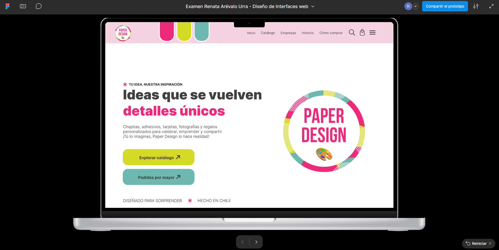

*Prototipo Figma*


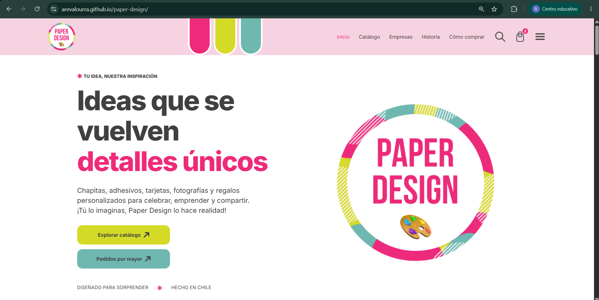

*Página web publicada*

Me voy feliz con este examen :)
