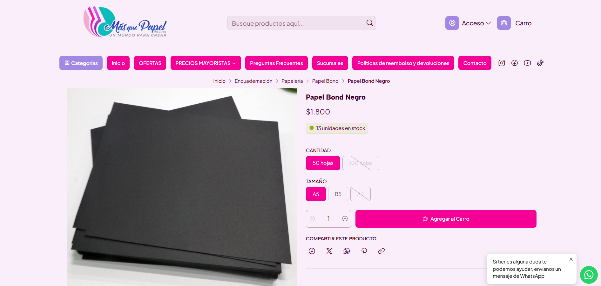
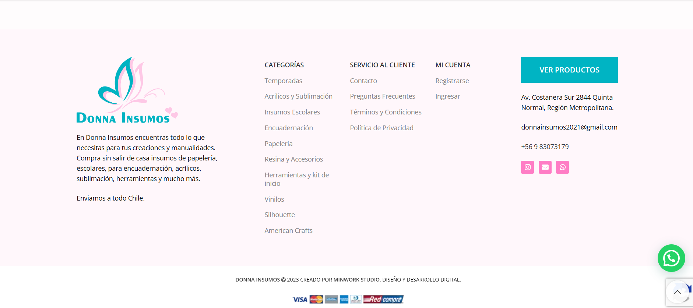
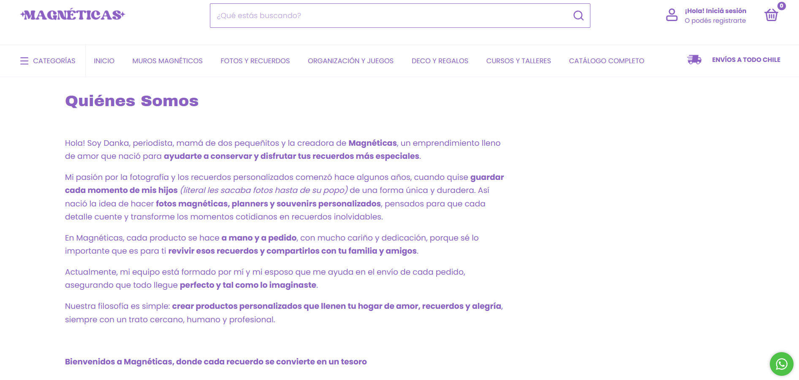

# Renata Arévalo Urra Paper Design - Bitácora de proyecto Examen

## Descripción general del proyecto

Este proyecto consiste en el diseño de una **página web tipo catálogo para Paper Design**, un emprendimiento familiar creado en 2020, dedicado a la papelería y los productos personalizados. Entre sus productos se encuentran chapitas, stickers, etiquetas, llaveros y otros artículos gráficos realizados a pedido.

La idea es contar con un espacio digital donde las personas puedan conocer los productos, revisar sus características, tamaños y precios, y consultar por pedidos personalizados de manera sencilla. También me interesa que la página muestre quién está detrás del emprendimiento: actualmente soy estudiante de **Diseño Industrial en la Universidad Diego Portales (UDP)**, y Paper Design ha sido un espacio para desarrollar mi creatividad y aprender nuevas técnicas de producción.

En esta primera etapa estoy explorando referentes de páginas comerciales que me ayuden a visualizar cómo presentar los productos y comunicar la historia de la marca. El diseño se trabajará inicialmente en **Figma, en formato MacBook Pro de 16 pulgadas**.

## Referentes web

### 1. Insumos Más que Papel

**Sitio:** [www.insumosmasquepapel.cl](https://www.insumosmasquepapel.cl/)

De este sitio me gusta su **estética general** y la manera en que organiza la información en las fichas de producto. La fotografía ocupa un espacio importante, mientras que al lado aparecen el nombre, el precio y los botones para seleccionar opciones como cantidad y tamaño. También destaco la navegación por categorías y el buscador.

Lo que más me interesa tomar como referencia es esa **selección de variantes y su relación con el precio**. Para Paper Design sería útil que, por ejemplo, al elegir el tamaño de una chapita y la cantidad solicitada, se pueda visualizar claramente el valor correspondiente. La actualización de precio es una funcionalidad que quisiera explorar en mi propuesta.

### 2. Donna Insumos

**Sitio:** [donnainsumos.cl](https://donnainsumos.cl/)

De esta página me llama la atención principalmente el **footer o pie de página**. Me gusta que esté distribuido en columnas y reúna el logotipo, una breve descripción de la tienda, enlaces a categorías, información de contacto y redes sociales sin verse desordenado.

Tomaría como referencia esta **organización y jerarquía de la información** para el cierre de la web de Paper Design, incorporando los datos de contacto, Instagram, enlaces al catálogo y una breve presentación del emprendimiento.

### 3. Magnéticas

**Sitio:** [www.magneticas.cl](https://www.magneticas.cl/)

De Magnéticas me gusta especialmente la sección **«Quiénes Somos»**. En lugar de limitarse a describir los productos, presenta a la persona detrás del negocio y cuenta cómo surgió la idea. El tono es cercano y personal, y las palabras destacadas en negrita ayudan a dar énfasis al relato.

Me gustaría tomar esta forma de **contar la historia del emprendimiento** para Paper Design: explicar sus inicios como proyecto familiar en 2020, su evolución con el tiempo y mi vínculo actual con el diseño. La intención es que quienes visiten la web no solo vean un catálogo, sino que también conozcan a la persona y la historia detrás de la marca.
