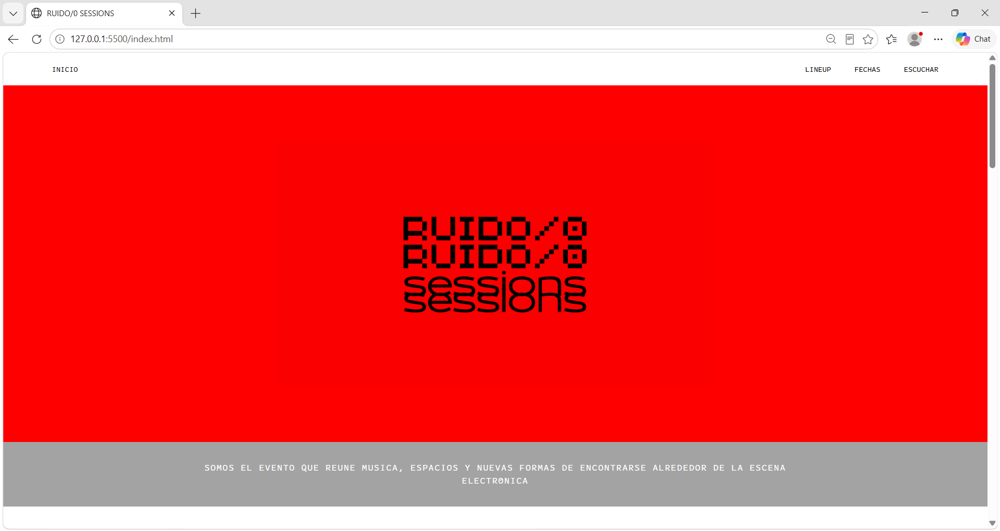
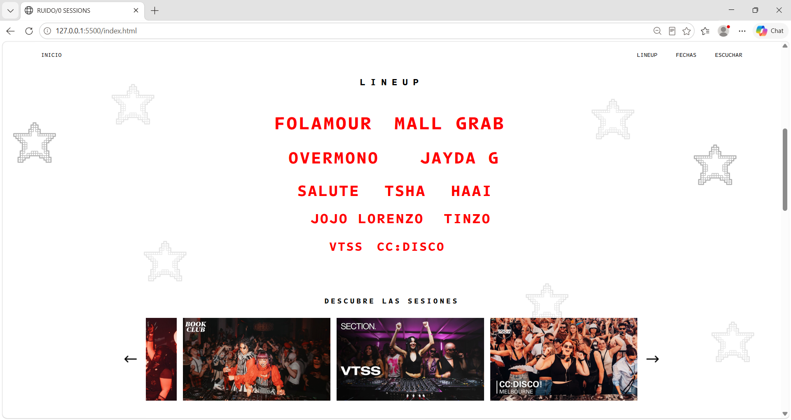
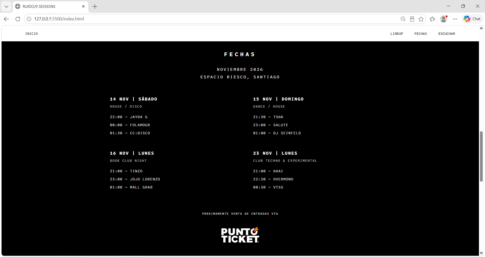
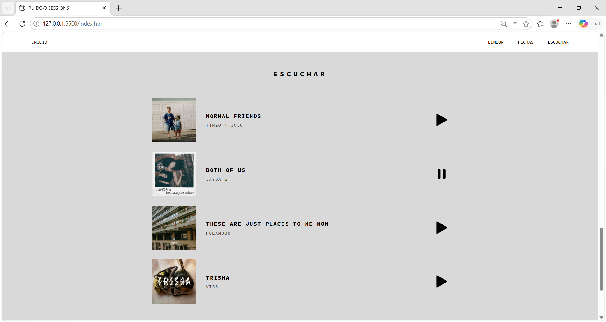
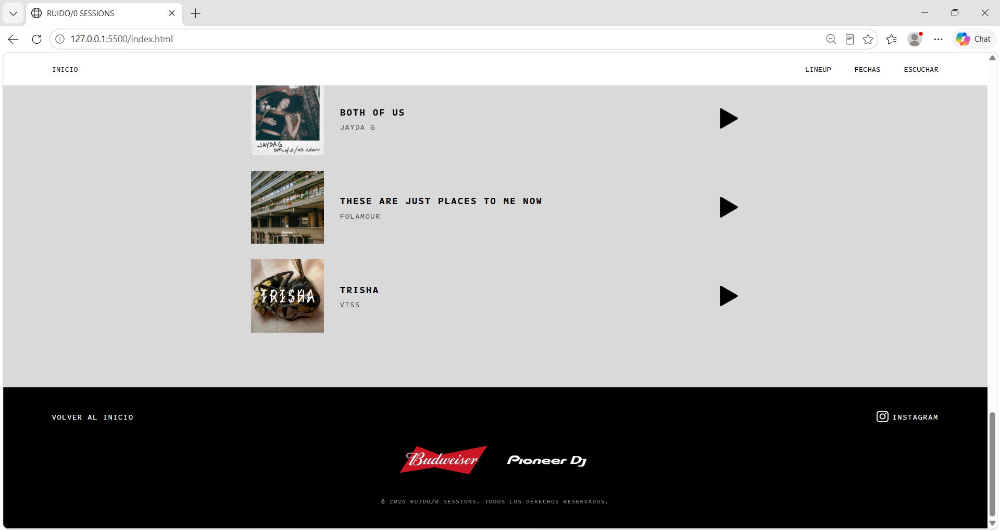

# Documentación personal Solemne 02

	1. Prototipo figma
	2. Herramientas usadas que hacen el trabajo más cómodo o práctico
	3. Escritura de código .html
	4. Redacción del prompt para la IA para .css
	5. Resultado final

---

## 1. Prototipo figma

Esta es una página de un evento ficticio de música electrónica, llamado RUIDO/0 SESSIONS el cual tiene la premisa de ser sesiones más que conciertos en sí, donde la gente comparte espacio con el dj.

Los colores que se usaron fueron rojo, blanco, gris y negro, para elementos destacados se usó el color rojo como por ejemplo el lineup.
La estructura de la página es: un header, el cual tiene la propiedad "sticky" que se realiza en el CSS, para que se mantenga siempre arriba incluso mientras uno navega por la página, esto para acceder a distintos lugares desde donde sea que estemos. Una portada, la cual contiene el fondo rojo y el logo en color negro, de inmediato una descripción que va abajo de la portada, un sección de lineup: se presentan 11 djs, un apartado de "descubrir sesiones" para que la gente pueda revisar sesiones de los djs, la sección de las fechas del evento, sección de escuchar y un footer en el cual se encuentra una opción para volver al inicio, auspiciadores y un link que dirige a instagram.

[imágenes figma]

## 2. Herramientas que hacen el trabajo más práctico

### Hack.md

El primer paso fue crear un espacio en el que pudiéramos trabajar de manera paralela por lo que encontré este editor de texto que va guardando casi cómo un Google docs, pero en formato markdown, lo cuál lo hace mucho más cómodo para escribir código. ¿por qué no hacerlo directamente en GitHub? porque si bien, este trabaja por medio de control de versiones, no se puede trabajar de manera simultánea. Así que es una buena opción por el tiempo y para no tener que estar esperando a que una persona termine de escribir una parte del código, etc.

La plataforma o editor más bien se llama: HackMD, adjunto de todas maneras el link a la carpeta acá para que puedan ver el proceso:
 
[Nuestro espacio de trabajo](https://hackmd.io/join/r1iG4-n2Gx)

### Links para la página web

Sitios donde encontré íconos para la pagina:

https://www.svgrepo.com/

https://www.flaticon.es/

### Material complementario

#### PDFS:

* Clase 07 

* Material de apoyo

* Rúbrica solemne 02

#### GitHub:

Clase-03: prompts de Janis para pedir CSS a la IA

#### Links y material de ayuda:

Para hacer el carrusel > https://www.w3schools.com/howto/howto_js_slideshow.asp (enviado por Natassja)

### Gemini y Claude

Para preguntas específicas, ayuda con escritura de etiquetas, problemas, revisión y arreglos en el código.

## Código .HTML

### Header / Inicio

Lo primero primerísimo en el código es colocar la estructura base del archivo HTML, que este se realiza automático con el comando "alt + ! y tab", y así solo modificamos lo editable.

La estructura generada automáticamente del `head` tiene por defecto el idioma en inglés, por lo que debemos cambiarlo en el atributo de `lang`al español.

El título que se visualizará en la barra superior del navegador se hace también en el head: `<title>RUIDO/0 SESSIONS</title>`.

Terminado este espacio del `<head>`, comencemos a escribir el cuerpo y esto se hace en el `<body>`.

Dentro del cuerpo del HTML deben ir por lo menos 3 cosas: el header, el main y el footer, en ese orden respectivamente.

Para crear el HTML tomé de referencia el último código trabajado en clases (actividad 03), en el *header* coloqué la estructura `<nav> con ul > li > a` para crear el menú que navega hacia distintas secciones del sitio. Y que además nos va a aparecer enlistado hacia abajo, pero no importa porque luego eso se arregla en el CSS.

Las secciones principales son:

- Inicio
- Lineup
- Fechas
- Escuchar

Luego en el `<main>` lo que haremos será empezar a dividir por secciones, en nuestra página contamos con 4 secciones principales y 2 secundarias:

1. `<section class="hero"></section>` y esta corresponde a la portada con su descripción abajo

2. `<section id="LINEUP" class="seccion-lineup">` corresponde al lineup

3. `<section id="DESCUBRE-SESIONES" class="sesiones">` es el componente que va debajo del lineup, para conocer las sesiones de los djs (esta no está en el header)

4. `<section id="FECHAS" class="fechas">` son las fechas del evento

5. `<!-- Componente 5: Escuchar -->` es una sección para escuchar la música lanzada por los artistas (lamntablemente es simbólica porque para realizar la función de escuchar se debe hacer en javascript y todavía no entiendo muy bien como usarla)

6. `<!-- Componente 6: Footer -->` que contiene auspiciadores, la función para volver al inicio y un links de instagram

* Problema que tuve: se me ocurrió hacer el logo en canvas y no me di cuenta que para exportar en formato svg te pide premium, así que quedó en formato png.

Por lo que quedó así:

```cpp
            <h1 class="logo-principal">
                
            </h1>
```

### El lineup:

```cpp
<!-- Componente 2: Lineup -->
        <section id="LINEUP" class="seccion-lineup">
            <h2>LINEUP</h2>

            <ul class="lineup-container">
                <li class="artist-name">FOLAMOUR</li>
                <li class="artist-name">MALL GRAB</li>

                <li class="artist-name">OVERMONO</li>
                <li class="artist-name">JAYDA G</li>

                <li class="artist-name">SALUTE</li>
                <li class="artist-name">TSHA</li>
                <li class="artist-name">HAAI</li>

                <li class="artist-name">JOJO LORENZO</li>
                <li class="artist-name">TINZO</li>

                <li class="artist-name">VTSS</li>
                <li class="artist-name">CC:DISCO</li>
            </ul>
        </section>

Aquí la lógica es hacer un listado con <ul> con los nombres de los djs:

<section id="LINEUP" class="seccion-lineup">
            <h2>LINEUP</h2>
 
            <ul class="lineup-container">

```

Separé los listados cada dos para los headliners y para los sub-headliners, de a 2, de a 3 y de a 2 para organizarlos luego como aparecían en el prototipo de figma.

La jerarquización es por el "reconocimiento" de los djs, de más a menos.

En el caso de que no se conozca a alguno de los djs hay un apartado justamente debajo del lineup para descubrir a cada uno de los djs. 
Este es el de:

### Descubre las sesiones

Este la idea era que quedase en un tipo de carrusel y que las flechas que colocamos a los costados funcionen como botones para recorrer por las miniaturas de los videos.
Cada una de las imágenes re dirigen a links de Youtube.


```cpp
        <!-- Componente 3: Sesiones -->
        <section id="DESCUBRE-SESIONES" class="sesiones">
            <h2>Descubre las sesiones</h2>

            <div class="carrusel-contenedor">

                <!-- Botón para volver a la tarjeta anterior -->
                <button
                    class="flecha flecha-izq"
                    type="button"
                    aria-label="Ver sesión anterior">
                    
                </button>

                <div class="carrusel">

                    <article class="tarjeta-sesion">
                        <a href="https://www.youtube.com/watch?v=IMijKmhuA7E&list=RDIMijKmhuA7E&start_radio=1">
                            
                        </a>
                    </article>

                    <article class="tarjeta-sesion">
                        <a href="https://www.youtube.com/watch?v=ddeAyYF_uwg&list=RDddeAyYF_uwg&start_radio=1">
                            
                        </a>
                    </article>

                    <article class="tarjeta-sesion">
                        <a href="https://www.youtube.com/watch?v=BpA2n8bvpOk&list=RDBpA2n8bvpOk&start_radio=1">
                            
                        </a>
                    </article>

                    <article class="tarjeta-sesion">
                        <a href="https://www.youtube.com/watch?v=tk1RHzS3kgM&list=RDtk1RHzS3kgM&start_radio=1">
                            
                        </a>
                    </article>

                    <article class="tarjeta-sesion">
                        <a href="https://www.youtube.com/watch?v=ulhdSOiTzx8&list=RDulhdSOiTzx8&start_radio=1">
                            
                        </a>
                    </article>

                    <article class="tarjeta-sesion">
                        <a href="https://www.youtube.com/watch?v=VG7ePskDBFM&list=RDVG7ePskDBFM&start_radio=1">
                            
                        </a>
                    </article>

                    <article class="tarjeta-sesion">
                        <a href="https://www.youtube.com/watch?v=1PcjSKvZiew&list=RD1PcjSKvZiew&start_radio=1">
                            
                        </a>
                    </article>

                    <article class="tarjeta-sesion">
                        <a href="https://www.youtube.com/watch?v=m9U8rppygmU&list=RDm9U8rppygmU&start_radio=1">
                            
                        </a>
                    </article>

                    <article class="tarjeta-sesion">
                        <a href="https://www.youtube.com/watch?v=M0Q152GFVkM&list=RDM0Q152GFVkM&start_radio=1">
                            
                        </a>
                    </article>

                    <article class="tarjeta-sesion">
                        <a href="https://www.youtube.com/watch?v=9piX0eeBjZo&list=RD9piX0eeBjZo&start_radio=1">
                            
                        </a>
                    </article>

                    <article class="tarjeta-sesion">
                        <a href="https://www.youtube.com/watch?v=pme0_g_0aPs&list=RDpme0_g_0aPs&start_radio=1">
                            
                        </a>
                    </article>

                </div>

                <!-- Botón para avanzar a la siguiente tarjeta -->
                <button
                    class="flecha flecha-der"
                    type="button"
                    aria-label="Ver sesión siguiente">
                    
                </button>

            </div>
        </section>
```

* Problema que tuve: esto pasó realizando ya el css, pero el carrusel incluyó unas flechas automáticas con una barra de deslizamiento. Esto les pedí a mis compañeras que lo solucionaran para que hicieran funcionar los botones.

Luego sigue la sección de las fechas

### Fechas

```cpp
        <!-- Componente 4: Fechas -->
        <section id="FECHAS" class="fechas">
            <h2>FECHAS</h2>
            <h3>NOVIEMBRE 2026 <br> ESPACIO RIESCO, SANTIAGO</h3>

            <div class="grilla-fechas">

                <article class="fecha-dia">
                    <h4>14 NOV | SÁBADO</h4>
                    <p class="genero">HOUSE / DISCO</p>
                    <ul class="horarios">
                        <li>22:00 — JAYDA G</li>
                        <li>00:00 — FOLAMOUR</li>
                        <li>01:30 — CC:DISCO</li>
                    </ul>
                </article>

                <article class="fecha-dia">
                    <h4>15 NOV | DOMINGO</h4>
                    <p class="genero">DANCE / HOUSE</p>
                    <ul class="horarios">
                        <li>21:30 — TSHA</li>
                        <li>23:00 — SALUTE</li>
                        <li>01:00 — DJ SEINFELD</li>
                    </ul>
                </article>

                <article class="fecha-dia">
                    <h4>16 NOV | LUNES</h4>
                    <p class="genero">BOOK CLUB NIGHT</p>
                    <ul class="horarios">
                        <li>21:00 — TINZO</li>
                        <li>23:00 — JOJO LORENZO</li>
                        <li>01:00 — MALL GRAB</li>
                    </ul>
                </article>

                <article class="fecha-dia">
                    <h4>23 NOV | LUNES</h4>
                    <p class="genero">CLUB TECHNO & EXPERIMENTAL</p>
                    <ul class="horarios">
                        <li>21:00 — HAAI</li>
                        <li>22:30 — OVERMONO</li>
                        <li>00:30 — VTSS</li>
                    </ul>
                </article>

                <p>PRÓXIMAMENTE VENTA DE ENTRADAS VÍA</p>
                

            </div>
        </section>

```

Los djs se separaron en 4 días por estilos musicales.

Para los días usé `<article class="fecha-dia">`

Y realicé la jerarquización así

Se le asigna `<h2>` a las fechas: `<h2>FECHAS</h2>`

`<h3>` al lugar del evento

y `<h4>` a las fechas como tal

luego dentro de los `<h4>` está el listado de los djs por cada día

### Escuchar

es la última sección dentro del `<main>`. 

```cpp
 <!-- Componente 5: Escuchar -->
        <section id="ESCUCHAR" class="escuchar">
            <h2>ESCUCHAR</h2>

            <div class="escuchar-container">

                <article class="tarjeta-track">
                    

                    <div class="info-track">
                        <h3>NORMAL FRIENDS</h3>
                        <p>TINZO + JOJO</p>
                    </div>

                    <input type="checkbox" id="track-1" class="play-checkbox">
                    <label for="track-1" class="play-boton" aria-label="Reproducir o pausar Normal Friends">
                        
                        
                    </label>
                </article>

                <article class="tarjeta-track">
                    

                    <div class="info-track">
                        <h3>BOTH OF US</h3>
                        <p>JAYDA G</p>
                    </div>

                    <input type="checkbox" id="track-2" class="play-checkbox">
                    <label for="track-2" class="play-boton" aria-label="Reproducir o pausar Both of Us">
                        
                        
                    </label>
                </article>

                <article class="tarjeta-track">
                    

                    <div class="info-track">
                        <h3>THESE ARE JUST PLACES TO ME NOW</h3>
                        <p>FOLAMOUR</p>
                    </div>

                    <input type="checkbox" id="track-3" class="play-checkbox">
                    <label for="track-3" class="play-boton" aria-label="Reproducir o pausar These Are Just Places to Me Now">
                        
                        
                    </label>
                </article>

                <article class="tarjeta-track">
                    

                    <div class="info-track">
                        <h3>TRISHA</h3>
                        <p>VTSS</p>
                    </div>

                    <input type="checkbox" id="track-4" class="play-checkbox">
                    <label for="track-4" class="play-boton" aria-label="Reproducir o pausar Trisha">
                        
                        
                    </label>
                </article>

            </div>
        </section>
```

Aquí se tomaron las imágenes de las portadas de algunas canciones de los artistas, el nombre de el track y del artista/s. No se colocaron todos ya que la idea es solo mostrar algunos lanzamientos de los dj y un botón de play.

Aquí los botones no tienen la funcionalidad de reproducir audio como tal ya que esa era una función de javascript. Por lo que el botón de play y pausa están como "imputs" más que imágenes fijas, entonces cuando se presiona el que se está mostrando actualmente se cambia al otro. Así demuestra estar reproduciendo o en pausa de manera simbólica.

Terminando el <main> está el footer, esto es lo que siempre vemos al final de las paginas web.

### Footer

```
<!-- Componente 6: Footer -->
    <footer class="pie-de-pagina">

        <div class="footer-enlaces">
            <a href="#INICIO" class="volver-inicio">VOLVER AL INICIO</a>

            <a href="https://www.instagram.com/" class="instagram-link">
                
                INSTAGRAM
            </a>
        </div>

        <div class="footer-auspiciadores">
            
            
        </div>

        <p class="creditos">
            © 2026 RUIDO/0 SESSIONS. TODOS LOS DERECHOS RESERVADOS.
        </p>

    </footer>
```

Se integró una forma de volver al inicio más rápido o más facil. Para no tener que subir desde la barra navegadora del costado.

---

Al finalizar el html le pedí a la IA que me hiciera un "roast me" o tipo auditara el código para saber si es que me estaba perdiendo de puntos específicos de la rúbrica.

## Consulta IA: Realizar un roast del código html final

### **Prompt usado:**
> Necesito que me ayudes auditando o haciendo un "roast" de este código de html que he escrito, considerando la rúbrica que te envío en este mismo mensaje.  Dime si es que identificas errores, inconsistencias o cualquier punto que deba corregir, para poder comenzar con el css.

### **Feedback:**
> Tu código HTML tiene una base excelente y cumple a la perfección con los requisitos del **Criterio 5: Estructura HTML5** para obtener el puntaje "Logrado". Utilizas correctamente las etiquetas semánticas obligatorias (`<header>`, `<main>` y `<footer>`) y cuentas con cinco etiquetas `<section>`, superando el mínimo exigido de dos.

Antes de pasar a tu hoja de estilos, debes corregir los siguientes detalles estructurales:

**Errores críticos de sintaxis**

* **Enlaces de YouTube mal formados:** En la sección "Descubre las sesiones", los atributos `href` de tus etiquetas `<a>` contienen sintaxis de Markdown mezclada con HTML. Actualmente dicen `href="[enlace](enlace)"`. Debes borrar los corchetes y paréntesis, dejando únicamente la URL limpia (ejemplo: `href="[https://www.youtube.com/watch?v=IMijKmhuA7E](https://www.youtube.com/watch?v=IMijKmhuA7E)..."`).
* **Anclas de navegación desconectadas:** En tu `<nav>` principal, los enlaces están apuntando a la nada (`href="#"`). Para que al hacer clic la página haga *scroll* hacia la sección correspondiente, debes enlazar los atributos `id` que ya creaste. Cambia `<a href="#">LINEUP</a>` por `<a href="#LINEUP">`, y repite la lógica con `#FECHAS` y `#ESCUCHAR`.

**Aciertos estructurales**

* Tienes un excelente uso de la etiqueta `<article>` para modular el contenido independiente, como los días del festival, las tarjetas de sesiones y los tracks de música.
* Todas tus etiquetas `` incluyen el atributo `alt` describiendo la imagen, lo cual es una excelente práctica de accesibilidad y orden.

**Próximos pasos para CSS**
Para comenzar a trabajar en el **Criterio 6: Estilos CSS**, tu primer paso debe ser conectar este documento con tu archivo externo. Recuerda insertar la etiqueta `<link rel="stylesheet" href="nombre-de-tu-archivo.css">` dentro del `<head>` para poder aplicar Flexbox y los colores de Figma como exige la rúbrica.

4. CSS asistido con IA

**Prompt usado:**

> Adjunto png de mi diseño en Figma: (escritorio de 1440 px), su link: https://www.figma.com/design/7lyP6np7CFFDHeS8GCOYm3/Solemne-2?node-id=0-1&p=f&t=kwRlZ54JmPWpORxb-0 y mi HTML. Escribe el CSS para que la página se vea como el png. Usa solo flexbox, unidades rem y %. No uses grid, position ni frameworks.
Comenta cada regla en español explicando qué hace, en lenguaje simple.

Prompt de nos pasó Janis para realizar el CSS una vez que tuviéramos listo el HTML.

Este primer acercamiento lo hice con Gemini por lo que no brindó tan buenos resultados, no eran tan fieles. Con Claude la vida se hizo más fácil y tomó el diseño de figma, cada dato los tomó y los aplicó al CSS. 

6. Resultado final










